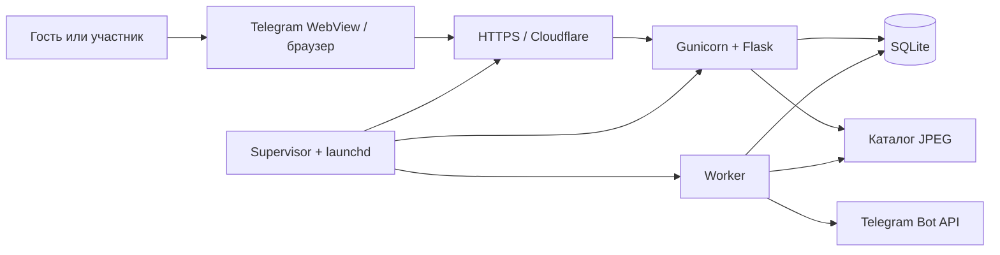

# Friends Auction: техническое исследование v1.1.0

Дата проверки: **24 ноября 2026 года**. Объект: commit [`45ccee95610328be1bdb23e5ae81325b6540f4d6`](https://github.com/PaVeLlLlLX/friends-auction/tree/45ccee95610328be1bdb23e5ae81325b6540f4d6), тег `v1.1.0`.

## Резюме

Для небольшого аукциона на одном сервере существующая архитектура соразмерна задаче. Проверка подписи Telegram, серверное разграничение ролей, транзакционная запись ставок, проверка ожидаемой цены и ограничение редактирования после первой ставки уже реализованы. Проведённые проверки не обнаружили обхода авторизации или выдачи чужих заявок обычному участнику. Эти результаты относятся к проверенным сценариям и не устанавливают отсутствие всех уязвимостей.

Дополнительные изолированные проверки обнаружили нарушения, не покрытые штатными тестами:

1. Запрос, допущенный до границы хранения, может сохранить имя и заявку после завершённой очистки. Нужна общая сериализация очистки и всех записей, включая обновление аккаунта при чтении API.
2. Первая ставка не содержит версии условий лота. Изменение описания до первой ставки может остаться незамеченным: `expected_price` остаётся `null`, старое подтверждение принимается.
3. Потеря HTTP-ответа после успешного создания лота оставляет возможность повторной публикации: ручной повтор создаёт второй лот. Нужен ключ операции и восстановление её результата.

Также подтверждены устаревающее уведомление следующему кандидату при параллельных действиях организатора, неверное отображение архивных ставок, потеря фокуса кнопок при обновлениях и недостаточный контраст части текста. Публичные фотографии не охвачены встроенным API rate limit. Это пробел контроля нагрузки; отказ в обслуживании в ходе проверки не воспроизводился.

**Три ближайшие задачи:** согласовать финальную очистку с записями, связать ставку с версией условий и сделать создание лота идемпотентным. Подробные задания и критерии приёмки приведены ниже. Исходники приложения, запущенный сервис и рабочие данные в ходе исследования не изменялись.

## 1. Метод и границы доказательств

Работа разделена на три параллельных направления с последующим сведением и повторной проверкой ключевых контрпримеров: безопасность и зависимости, корректность торгов, интерфейс и уведомления. Эксплуатация, резервное копирование, жизненный цикл данных и ограниченный правовой скрининг рассмотрены при сведении. Это автоматизированное исследование исходников и изолированных сценариев, без сторонней сертификации.

Полные разборы:

- [Безопасность и зависимости](security.md).
- [Корректность торгов](correctness.md).
- [Мобильный интерфейс и уведомления](ux.md).
- [Протоколы проверок](evidence/validation.md) и JSON-результаты в [evidence](evidence/).

Прочитаны README, спецификация, документация развёртывания, серверные модули, supervisor и скрипт launchd, frontend, локализация, Docker/Compose и CI, соответствующие тесты. Дополнительно просмотрены скрипты настройки и интеграционного запуска. Основой выводов служит закреплённый локальный код; внешние материалы сверены с первичными документациями и upstream release notes. Количество найденных ссылок не используется как показатель качества.

Статусы доказательства:

| Статус                  | Значение                                                                           |
| ----------------------- | ---------------------------------------------------------------------------------- |
| Воспроизведено          | Проверка действительно выполнена; указаны входы, изоляция и наблюдаемый результат. |
| Подтверждено кодом      | Путь прочитан в указанном commit; внешняя эксплуатация не заявляется.              |
| Подтверждено источником | Вывод поддерживает открытая документация или публикация сопровождающего.           |
| Требует проверки        | Есть конкретная гипотеза или эксплуатационное условие, но нужный тест не выполнен. |
| Не установлено          | Данных или доступа недостаточно.                                                   |

Применялись временные SQLite и фотографии, вымышленные Telegram ID и тестовый токен, offline-адаптеры доставки и отдельный headless browser. Реальные участники, конфигурация, фотографии и база рабочего окружения не читались. Запросы к работающему публичному приложению и боту не отправлялись. Не проводились нагрузочная атака, испытание отказа питания, аппаратные проверки Telegram iOS/Android и проверка реальной доставки.

Фактическая среда: macOS, arm64, Python **3.12.14**, SQLite **3.53.4**. Штатная suite: **54 passed**. Ruff lint/format, строгий mypy, TypeScript `checkJs` и Prettier прошли. Сборка и runtime контейнеров в этой сессии не проверены: Docker daemon недоступен, плагин Compose отсутствует. Содержимое CI проверено статически; старый зелёный запуск не называется новым воспроизведением.

## 2. Архитектура и модель угроз

Границы доверия: подписанные данные Telegram проверяются на сервере; подпись не равна одобрению участника. Username служит подписью для узнавания, полномочия определяются числовым ID. Организатор обладает всеми разрешёнными правами изменения лотов и допуска. Компрометация его Telegram-аккаунта или токена бота выходит за пределы защиты от обычного участника. Локальный владелец процесса имеет доступ к файлам и секретам.

Проверенные роли: гость получает 401 на административный API, подписанный неодобренный пользователь — 403, организатор — 200. Изменённые подписанные данные организатора получают 401. Публичный каталог не содержит имён заявителей. Точная реализация, ограничения повторного использования `initData`, прокси-заголовков, CSP и загрузок разобраны в [security.md](security.md).

Отдельные угрозы для этого масштаба: массовые запросы к публичному каталогу/фотографиям; заявки с множества настоящих Telegram-аккаунтов; недобросовестные ставки уже одобренного участника; случайные параллельные действия организатора; потеря сети, сна или питания единственного хоста. Утверждение, что единственный оставшийся риск — спам одобренных пользователей, результатами исследования не поддерживается.

## 3. Приоритеты

P0 — необходимость немедленно остановить эксплуатацию; в проверенных сценариях не установлен. P1 — нарушение существенной гарантии, которое требуется закрыть до соответствующей границы жизненного цикла. P2 — адресное исправление корректности, UX или эксплуатационной устойчивости. P3 — улучшение сопровождения и публикации. Это локальная оценка для данного аукциона, без присвоения CVSS.

| ID / ссылка                                                                                             | Приоритет и срок                             | Доказательство                                                                                                               | Действие                                                                                              |
| ------------------------------------------------------------------------------------------------------- | -------------------------------------------- | ---------------------------------------------------------------------------------------------------------------------------- | ----------------------------------------------------------------------------------------------------- |
| [BID-01](correctness.md#bid-01-запись-заявки-после-окончательной-очистки)                               | P1 до окончания хранения                     | Реальный request-thread, управляемое время и барьер: после пустой БД и завершения `tick` заявка получает 200 и сохраняет имя | Проверка срока внутри сериализованных записей; очистка после всех допустимых записей                  |
| [BID-02](correctness.md#bid-02-первая-ставка-не-связывается-с-версией-условий-лота)                     | P2 до завершения торгов                      | Последовательные API-запросы: правка условий, затем старая первая ставка → 200                                               | `revision` условий в карточке и обязательном подтверждении ставки                                     |
| [UX-01: повтор создания](ux.md#ux-01--p2-неизвестный-результат-публикации-допускает-создание-дубликата) | P2 до следующего изменения админского потока | Headless browser: commit без ответа → ручной повтор → два лота                                                               | Ключ операции создания и получение уже сохранённого результата                                        |
| [BID-03](correctness.md#bid-03-уведомление-уже-отказавшему-следующему-кандидату)                        | P2 до выдачи результатов                     | Offline send-adapter: после проверки кандидата отказ переводит выбор на другого, сообщение уходит прежнему                   | Сериализация смены кандидата и состояния отправки по лоту                                             |
| UX-02: архивная история                                                                                 | P2 до использования архива                   | Карточка истории ведёт на 404; статус выводится из отсутствующего публичного лота                                            | Поля состояния архива в собственном API истории и доступный приватный просмотр                        |
| UX-03/04: фокус и контраст                                                                              | P2 до финальной проверки устройств           | Фокусированная кнопка удаляется при polling; два контраста около 3:1                                                         | Сохранение фокуса/узлов, контраст обычного текста не ниже 4.5:1                                       |
| SEC-01: публичные фото                                                                                  | P2 до широкого распространения ссылки        | API достигает 429, те же 305 запросов фото проходят с 200                                                                    | Ограничения запросов и пропускной способности на доступном edge/reverse proxy                         |
| SEC-02: Gunicorn                                                                                        | P2 при ближайшем обслуживании                | Unit probe парсера + upstream исправление; внешний DoS не доказан                                                            | Проверенное обновление до исправленного patch-релиза с прогоном регрессий                             |
| SEC-03: зависимости                                                                                     | P2 при ближайшем обслуживании                | Свежая резолюция Click отличается от установленной; CI не вызывает pip-audit                                                 | Полный runtime lock/constraints и настоящий CI-аудит                                                  |
| OPS-01: restart launchd                                                                                 | P2 до следующего обновления                  | Статически: сразу `bootout`, затем однократный `bootstrap`, без ожидания удаления регистрации                                | Ограниченное ожидание/повтор с диагностикой и проверкой готовности                                    |
| DATA-01: внешние копии                                                                                  | P2 до окончания хранения                     | Cleanup затрагивает только настроенные таблицы и JPEG; остальное не инвентаризируется                                        | Реестр управляемых копий, проверяемое удаление и точный пользовательский текст                        |
| PUB-01: происхождение релиза                                                                            | P3                                           | `/api/version` возвращает семантическую версию; LICENSE отсутствует                                                          | Метаданные commit/build без секретов; явно выбрать лицензию при намерении разрешить переиспользование |

Статус кандидата, цена и транзакция ставки защищены лучше, чем операции вокруг внешней доставки и финальной очистки. Поэтому исправления должны закрывать конкретные границы операций, сохраняя действующие правила аукциона.

## 4. Корректность и интерфейс

### Что можно сохранить

Один процесс Gunicorn с четырьмя потоками, SQLite и явные транзакции записи достаточны как исходная архитектура для небольшой аудитории. Дополнительные контроли показали: отзыв допуска во время ожидания SQLite lock отклоняет ставку с 403; наступление `END` во время того же ожидания — с 409. Ранжирование использует лучшую ставку каждого уникального участника, отказы не уничтожают историю. Подробности и первичные источники SQLite приведены в [correctness.md](correctness.md).

Не требуется менять фиксированный дедлайн **12.12.2026 23:59:00 UTC+7**, добавлять продление или автоматическую выдачу без торгов. Поздняя ставка и риск не успеть при фиксированном сроке — свойства выбранного механизма. Серверное время и проверка под write lock определяют принятие; время получения HTTP-ответа участником не является точной границей транзакции.

Polling примерно раз в три секунды остаётся приемлемым для этого масштаба. Переход на WebSocket/SSE сам по себе не решает атомарность, неизвестный результат записи или сохранение фокуса. Headless-проверка подтвердила, что ввод суммы и фокус поля сохраняются при обновлении ставки другим участником; Enter не отправляет ставку, первая нулевая ставка требует явного подтверждения. Нужны адресные исправления кнопок и архивной истории, описанные в [ux.md](ux.md).

### Неопределённый результат записи

Интерфейс уже сообщает, что действие могло сохраниться, если ответ не получен. Но сообщение не даёт серверной идемпотентности: при создании лота повтор с тем же содержимым — новая операция. При ставке старую ожидаемую цену дополнительно защищает сервер; переносить этот вывод на создание лота или Telegram-уведомление нельзя. Нужны отдельные состояния `saving`, `saved`, `unknown` и способ запросить результат по идентификатору операции.

### Уведомления

Сводка с 18:00 UTC+7 и объединение событий следует сохранить. В последний час предусмотрены отдельное напоминание и более оперативные outbid-сообщения. Повтор между внешней доставкой и сохранением receipt остаётся возможным; спецификация уже честно описывает эту границу. Нет основания обещать exactly-once или гарантированное прочтение до закрытия.

Для смены победителя особенно важно фиксировать, кому организатор подтвердил уведомление. Параллельные notify/refuse имеют административные права с обеих сторон. Проблема относится к согласованности нескольких вкладок/устройств организатора; это не найденный путь анонимного злоумышленника.

## 5. Эксплуатация и восстановление

### Подтверждённые свойства

[`service_environment`](https://github.com/PaVeLlLlLX/friends-auction/blob/45ccee95610328be1bdb23e5ae81325b6540f4d6/auction/service.py#L109-L122) принудительно отключает demo/trial и выбирает отдельное хранилище. Supervisor проверяет локальную версию/режимы, публичный каталог и завершение дочерних процессов, меняет кнопку меню бота при новом URL. Есть файловая блокировка supervisor и отдельная блокировка worker, приватная конфигурация, ротация и редактирование логов. Завершившаяся очистка останавливает службу без штатного restart loop. Эти свойства проверены кодом и соответствующей частью штатных тестов, а не наблюдением текущего развёртывания.

### OPS-01: перезапуск требует ожидания снятия регистрации

В [`control`](https://github.com/PaVeLlLlLX/friends-auction/blob/45ccee95610328be1bdb23e5ae81325b6540f4d6/scripts/macos_service.py#L52-L61) `restart` сразу выполняет `bootstrap` после `bootout`. Результат остановки при restart не разбирается, повтор и ожидание отсутствуют. Локальный `man launchctl` проверен; этот аудит не устанавливает, что `bootout` гарантирует готовность немедленного повторного `bootstrap` во всех состояниях. Ранее зафиксированное поведение другой сессии не считается новым воспроизведением.

Рекомендация: ограниченно проверять исчезновение конкретной регистрации через `launchctl print`, отличать отсутствие службы от отказа доступа, повторять только ожидаемую переходную ошибку и завершаться понятной диагностикой по timeout. Приёмка — отдельный временный тестовый label с медленным shutdown, несколько повторов restart и отсутствие лишнего web/worker. Действующая служба в ходе исследования не перезапускалась.

### Резервное копирование

Синтетический тест создал лот с фотографией, одобрил участника и сохранил нулевую ставку. SQLite backup API сделал копию базы; при отсутствии конкурентных записей скопирован каталог JPEG. После восстановления в другой временный каталог: `integrity_check=ok`, `foreign_key_check` пуст, одна ставка/лот/фотография и два аккаунта сохранены; фотография доступна с HTTP 200 и совпадающим SHA-256, собственная история доступна с HTTP 200.

Это подтверждает ограниченный сценарий восстановления данных. Он не доказывает восстановление настоящего сервиса после отказа диска и не доказывает согласованность произвольной живой копии фотографий с БД. [SQLite backup API](https://www.sqlite.org/backup.html) обеспечивает снимок базы; общую точку БД и файлов должен обеспечить оператор. Для небольшого набора лотов достаточно остановить записи на время снимка и копирования, проверить manifest файлов, восстановить копию в отдельный каталог и проверить роли/историю/фото. Подтверждённой процедуры восстановления реального production-backup в этой сессии нет.

### Наблюдаемость и остановка

После startup supervisor проверяет главным образом `process.poll()`. Живой процесс с зависшим HTTP-путём не равен доступному приложению. Полезны ограниченный локальный health probe и журнал последнего успешного tick/доставки без персональных данных; внешний мониторинг добавляется по необходимости, не как обязательный платный сервис. Остановка эскалирует SIGTERM до kill после пяти секунд: обработку прерванных записей и неизвестного HTTP-результата следует учитывать в тестах, не объявляя эту эскалацию доказанной порчей SQLite.

### Сравнение размещения

| Вариант                          | Преимущество                                                     | Ограничения и затраты                                                                        | Вывод для этого проекта                                                                     |
| -------------------------------- | ---------------------------------------------------------------- | -------------------------------------------------------------------------------------------- | ------------------------------------------------------------------------------------------- |
| Mac + Quick Tunnel               | Существующий способ, без покупки домена и отдельной VM           | Питание, сессия, сеть, смена hostname; электричество и операторское время не измерены        | Сохранить при принятом риске доступности и проверенном восстановлении                       |
| Mac + управляемый Tunnel + домен | Постоянный origin и проще возвращение после перезапуска          | Домен и настройка; сон/отключение Mac остаются                                               | Разумный следующий шаг, если требуется постоянная ссылка                                    |
| Одна небольшая VM/VPS            | Независимость от крышки, пользовательской сессии и домашней сети | Регулярная оплата, обновления ОС, копии, перенос и проверка применимости требований к данным | Рассматривать при требовании непрерывной доступности; переписывание приложения не требуется |

Cloudflare прямо ограничивает Quick Tunnel: без uptime guarantee, до 200 одновременных запросов, без SSE, новый hostname при создании. Это ограничение доступности выбранного способа, не найденный обход Telegram-авторизации. [Quick Tunnels, актуальная документация](https://developers.cloudflare.com/tunnel/get-started/quick-tunnels/).

Управляемый Tunnel указан как доступный на всех планах; стоимость домена зависит от зоны и регистратора. На странице Selectel публично заявлен ориентир **от 0.27 ₽/ч**; доступный текст не дал надёжной полной сметы нужной конфигурации с диском/IP/backup. Поэтому цена конкретной VM в отчёте не утверждается. Тариф и доступность должны быть проверены в калькуляторе перед покупкой; ресурсы не заказывались. [Cloudflare Tunnel](https://developers.cloudflare.com/tunnel/), [Selectel: почасовые VPS/VDS](https://selectel.ru/services/cloud/vps-vds/hourly-paid/).

`caffeinate -s` действует при питании от сети согласно локальной man-page. Per-user LaunchAgent зависит от пользовательской сессии; Apple описывает отправку SIGTERM пользовательским агентам при logout. Этот способ запуска не следует описывать как независимый от выключения, сна или выхода из аккаунта. [Apple: Creating Launch Daemons and Agents](https://developer.apple.com/library/archive/documentation/MacOSX/Conceptual/BPSystemStartup/Chapters/CreatingLaunchdJobs.html).

### Обновление и откат

Сохранить развёртывание в отдельный каталог релиза. Перед переключением — согласованная копия данных и проверка совместимости схемы. Откат на `v1.0.0` поверх БД `v1.1.0` небезопасен для архивной приватности: просмотр кода старого тега подтвердил отсутствие фильтра нового `deleted` в публичных запросах лотов/фотографий. Следует откатывать на совместимый исправленный релиз либо вместе с согласованным снимком данных, понимая потерю более новых записей. Откат с реальными данными не выполнялся.

## 6. Приватность и жизненный цикл

| Категория                           | Состав и доступ                                                                   | Что делает приложение / что требуется отдельно                                                                            |
| ----------------------------------- | --------------------------------------------------------------------------------- | ------------------------------------------------------------------------------------------------------------------------- |
| SQLite                              | Telegram ID, профиль, имена заявки, допуск, ставки, события/подписки              | `tick` удаляет семь таблиц; BID-01 нарушает окончательность при конкурирующем запросе                                     |
| JPEG                                | Публичные фото активных/неудалённых лотов; архивные файлы сохраняются локально    | Cleanup удаляет `*.jpg` только в настроенном каталоге; исходные файлы в других местах не охвачены                         |
| SQLite journal/WAL, временные файлы | Возможные промежуточные копии данных                                              | `secure_delete` и `VACUUM` не равны стиранию всех внешних файлов и snapshots; фактический режим хранилища нужно учитывать |
| Browser/WebView                     | Уже загруженные данные, изображения, история/состояние вкладки                    | Сервер может прекратить выдачу, но не гарантирует удаление всех клиентских копий                                          |
| Telegram                            | Переписка с ботом и доставленные уведомления                                      | Worker не удаляет отправленные сообщения; это отдельный срок/механизм хранения Telegram                                   |
| Cloudflare                          | Сетевые метаданные и проксируемый трафик                                          | Удаление локальной БД не задаёт срок внешнему провайдеру                                                                  |
| Логи/конфигурация                   | Диагностика, частные пути, bot token и admin ID в конфиге                         | Ротация и редактирование логов есть; общий purge логов/конфига cleanup не выполняет                                       |
| Другие окружения и копии            | Demo/trial БД, исходные фото, backups, старые релизы, Time Machine/APFS snapshots | Требуют инвентаризации, отдельного решения об удалении и проверки восстановления после очистки                            |

Основание: [`worker.tick`](https://github.com/PaVeLlLlLX/friends-auction/blob/45ccee95610328be1bdb23e5ae81325b6540f4d6/auction/worker.py#L120-L142), [SQLite secure_delete](https://www.sqlite.org/pragma.html#pragma_secure_delete), [SQLite VACUUM](https://www.sqlite.org/lang_vacuum.html), [политика Telegram, раздел 6](https://telegram.org/privacy#6-bot-messages), [политика Cloudflare](https://www.cloudflare.com/privacypolicy/). Эти источники не подтверждают физическое стирание всех копий приложения.

**DATA-01.** Фраза «все данные до 31 января» должна иметь определённый охват. README уже указывает, что исходные материалы и backups удаляются отдельно; интерфейс сообщает общий срок без этого уточнения. До границы **01.02.2027 00:00 UTC+7** нужен перечень управляемых копий: место/категория, владелец, срок, способ удаления, проверка и исключения. Секретный token следует рассматривать как эксплуатационный секрет; завершение аукциона — повод прекратить использование/отозвать его по отдельному решению, а не считать его автоматически очищенным.

Предлагаемая формулировка после устранения BID-01 и подготовки процедуры: «Данные аукциона и фотографии на сервере хранятся до 31 января 2027 года включительно. После этого доступ закрывается; данные удаляются обработчиком, а при его остановке — после следующего запуска. Резервные и исходные копии удаляются отдельно по тому же сроку. Сообщения, уже доставленные в Telegram, и сохранённые вами копии могут остаться». Если последний срок для копий технически не обеспечен, обещание нужно заменить фактической политикой, а не оставлять неподтверждённую гарантию.

## 7. Публичность и ограниченный правовой скрининг

Публичный репозиторий позволяет прочитать исходники, но отсутствие LICENSE не предоставляет явно выбранную open-source лицензию. Семантическая строка `/api/version` не доказывает соответствие обслуживаемого процесса опубликованному commit. Для прослеживаемости достаточно добавить commit/build identity в образ и релиз, хранить manifest/контрольные суммы и показывать публично только безопасные метаданные. Это не удалённая аттестация процесса. Подробности — [security.md](security.md).

В опубликованном ТФОМС тексте 152-ФЗ в редакции 26.07.2026 предусмотрено исключение для обработки физлицом исключительно для личных/семейных нужд при соблюдении прав субъектов. Применимость исключения к публичной ссылке с ручным допуском знакомых этим исследованием не установлена. Если исключение неприменимо, требуют отдельной проверки основания обработки, уведомление, локализация и трансграничная передача; одного UI-согласия недостаточно для вывода о соблюдении всех требований. Это перечень вопросов, не заключение о нарушении. [Текст закона, ст.1, 12, 18, 22](https://www.tfoms18.ru/media/files/fz_152.pdf).

ФНС отдельно указывает, что доход от продажи личных вещей не является объектом НПД; это не утверждение об отсутствии любых налоговых обязанностей. [ФНС: вопросы и ответы](https://npd.nalog.ru/faq/).

Не установлены фактическая география всех копий, статус и регулярность продаж, гражданство субъектов и юридический момент заключения договора. Проверка применимости норм о заключении договора на торгах не завершена: официальный портал нормативного текста отвечал timeout. Имеющиеся факты не дают основания автоматически классифицировать этот проект как азартную игру или коммерческий маркетплейс. [Минюст: Гражданский кодекс](https://minjust.gov.ru/ru/pages/grazhdanskij-kodeks/). Нужна отдельная предметная правовая оценка при расширении аудитории или смене модели использования.

## 8. План работ

Оценки — инженерные диапазоны, без измеренного исполнения. Порядок отражает зависимости и жизненный цикл, а не одинаковую срочность всех пунктов.

### Три задания для реализации

| Задание                          | Содержание                                                                                                                                             | Оценка / риск             | Критерий готовности                                                                                                                                                |
| -------------------------------- | ------------------------------------------------------------------------------------------------------------------------------------------------------ | ------------------------- | ------------------------------------------------------------------------------------------------------------------------------------------------------------------ |
| 1. Окончательность очистки       | Общая дисциплина транзакций для account upsert и других PII-записей, проверка `DELETE_AFTER` внутри неё; одинаковое поведение native/Compose           | 0.5–1.5 дня, средний риск | Оба порядка application/me ↔ cleanup проверены барьерами; после всех потоков семь таблиц пусты, фото отсутствуют, новые успешные PII-записи невозможны             |
| 2. Версия подтверждённых условий | Аддитивная миграция `revision`, обновление при изменении условий, поле в API/JSDoc, обязательная проверка в ставке под write lock                      | 3–6 ч, средний риск       | Старая revision после правки только описания даёт 409 без ставки; новая проходит; нулевой старт/шаги/гонки edit-bid работают                                       |
| 3. Повтор создания лота          | Клиентский идентификатор одной попытки, серверное хранение результата/уникальность, восстановление после неизвестного ответа; безопасная работа с фото | 0.5–1 дня, средний риск   | Ответ после commit теряется; повтор с тем же ключом возвращает тот же lot ID, в БД и каталоге файлов один комплект; изменённый payload с тем же ключом отклоняется |

Каждое задание требует regression-теста, строгих типов, проверок проекта и проверки затронутого пользовательского потока. Исправления и выкладка в рабочее окружение в рамки данного исследовательского отчёта не входят.

### Ближайшие 24–48 часов

Запланировать три задания выше, сначала воспроизводящие regression-тесты. Сохранить контрольный согласованный снимок перед будущим обновлением. Исправить ложные статусы архива и недоступные переходы. Проверить patch-обновление Gunicorn и транзитивный lock в отдельном окружении; не менять версии на работающем сервисе без проверки. Время не следует обещать как сумму всех верхних оценок, выполнимую одним человеком за 48 часов.

### До закрытия торгов 12 декабря

Завершить revision/идемпотентность и поправить архивный UX; фокус/контраст проверять вместе с ними. Провести ручные проверки Telegram iOS/Android, нейтральных текстов и клавиатуры. Проверить restart на изолированной службе, обработку потери сети, обновление кнопки после смены Quick Tunnel URL, восстановление синтетического backup. Выбрать допустимый режим доступности на день закрытия; переносить стек на VPS без такой потребности не требуется.

### До окончания хранения

Устранить BID-01, проверить оба режима запуска и повторную очистку после сбоя/остановки. Подготовить реестр копий, исключений и протокол удаления. Если есть WAL/snapshots/backups, отдельно проверить их судьбу и возможность восстановления удалённых данных из старой копии. Закрыть согласованность notify/refuse до фактической работы с резервными кандидатами.

### Отложенные улучшения

Стабильный домен, ограниченная health-наблюдаемость, build identity и лицензия. Возможность замены фотографий после ставок требует отдельного решения о неизменности условий; добавлять её как обычный CRUD без revision/history не следует. Микросервисы, горизонтальная БД и переписывание frontend не обоснованы найденными дефектами.

## 9. Матрица выпуска

| Проверка                              | Среда                                       | Требуемое наблюдение                                       | Статус 24.11                                               |
| ------------------------------------- | ------------------------------------------- | ---------------------------------------------------------- | ---------------------------------------------------------- |
| Подпись/роли/собственные данные       | Flask clients + fake initData               | 401/403 для чужих прав, отсутствие чужих PII               | Пройдены проверенные сценарии                              |
| Две ставки и актуальность допуска/END | Отдельные connections, barriers             | Один победивший commit; stale/late/revoked отклоняются     | Штатные и дополнительные контроли пройдены                 |
| Первая ставка после edit              | API + будущая revision                      | 409 по старым условиям                                     | Найден дефект                                              |
| Запись одновременно с purge           | Fake clock + реальный поток                 | После завершения нет PII                                   | Найден дефект                                              |
| Потерянный ответ create               | Отдельный headless browser + fault          | Один lot ID после повтора                                  | Найден дефект                                              |
| Notify/refuse                         | Offline delivery adapter                    | Зафиксирован согласованный получатель и состояние          | Найден дефект                                              |
| Фото/приватный архив                  | Tmp JPEG/БД, гость/участник/организатор     | Публичные 404; корректная приватная история                | Серверное скрытие работает; UX истории требует исправления |
| Enter/0/draft polling                 | Headless browser, ширина 390                | Enter не отправляет; подтверждение 0; черновик сохраняется | Пройдено в эмуляции                                        |
| Фокус кнопок/контраст                 | DOM + расчёт контраста                      | Фокус сохраняется, обычный текст ≥4.5:1                    | Найдены дефекты                                            |
| Backup + фото restore                 | Полностью синтетическое idle-хранилище      | integrity ok, FK0, история/фото200, hash совпадает         | Пройден ограниченный сценарий                              |
| Compose/build/recreate                | Изолированный Docker daemon/volume          | Те же проверки доступа и сохранения                        | Не выполнено: инструменты недоступны                       |
| Restart/logout/sleep/network          | Отдельная служба и целевой Mac              | Предсказуемая остановка/восстановление без двух workers    | Не воспроизведено аппаратно                                |
| Telegram iOS/Android                  | Тестовый бот/аккаунты, настоящие устройства | Клавиатура, modal/focus, safe areas, доставка              | Не выполнено                                               |

## 10. Источники и ограничения

Реестры первичных Telegram, SQLite, Python, Flask, Pillow/Gunicorn и W3C источников находятся рядом с конкретными выводами в трёх приложениях. Дополнительные источники сводного отчёта:

| Организация / материал                                                                                                                               | Версия или дата проверки                                                 | Поддерживаемый вывод                                                           |
| ---------------------------------------------------------------------------------------------------------------------------------------------------- | ------------------------------------------------------------------------ | ------------------------------------------------------------------------------ |
| [SQLite Online Backup API](https://www.sqlite.org/backup.html)                                                                                       | Прочитан 24.11.2026                                                      | Согласованная копия БД, не совместный снимок произвольных файлов               |
| [SQLite secure_delete](https://www.sqlite.org/pragma.html#pragma_secure_delete), [VACUUM](https://www.sqlite.org/lang_vacuum.html)                   | Прочитаны 24.11.2026                                                     | Охват очистки внутри SQLite; не гарантия удаления внешних копий                |
| [Cloudflare Quick Tunnels](https://developers.cloudflare.com/tunnel/get-started/quick-tunnels/)                                                      | На странице обновление 30.09.2026                                        | Ограничения временного туннеля                                                 |
| [Cloudflare Tunnel](https://developers.cloudflare.com/tunnel/)                                                                                       | На странице обновление 18.11.2026                                        | Стабильная конфигурация публичного hostname и доступность по планам            |
| [Apple launchd guide](https://developer.apple.com/library/archive/documentation/MacOSX/Conceptual/BPSystemStartup/Chapters/CreatingLaunchdJobs.html) | Архивная официальная документация; сверена с локальными man-pages        | Зависимость LaunchAgent от сессии; не подтверждение отсутствия проблем restart |
| Apple `launchctl(1)`, `caffeinate(8)`                                                                                                                | Локальные man-pages прочитаны 24.11.2026                                 | Команды lifecycle и AC-only assertion                                          |
| [Telegram Privacy Policy](https://telegram.org/privacy#6-bot-messages)                                                                               | Прочитана 24.11.2026                                                     | Внешняя граница данных бота                                                    |
| [Cloudflare Privacy Policy](https://www.cloudflare.com/privacypolicy/)                                                                               | Прочитана 24.11.2026                                                     | Внешняя обработка сетевых данных                                               |
| [Selectel VPS/VDS](https://selectel.ru/services/cloud/vps-vds/hourly-paid/)                                                                          | Открыта 24.11.2026                                                       | Рекламный нижний ориентир; не точная смета                                     |
| [152-ФЗ, копия ТФОМС](https://www.tfoms18.ru/media/files/fz_152.pdf)                                                                                 | Редакция 26.07.2026, сохранение 09.11.2026                               | Нормативный текст ограниченного скрининга; не официальная публикация поправки  |
| [ФНС FAQ](https://npd.nalog.ru/faq/), [Минюст: ГК](https://minjust.gov.ru/ru/pages/grazhdanskij-kodeks/)                                             | FAQ доступен в поисковом извлечении; страница Минюста открыта 24.11.2026 | Узкие указания на предмет правовой проверки                                    |

Ограничения доступа: официальная публикация поправок на pravo.gov.ru и страница закона на Минтруде отвечали timeout; страница цен Hetzner из поиска — 404, числовой тариф основной страницы не извлечён. Поэтому ни эта цена, ни полнота актуальной правовой проверки не утверждаются. Проверка advisory зависит от доступных баз и момента запроса; пустой ответ `pip-audit` не отменяет upstream исправления, которое ещё не связано с advisory.

Открытые вопросы: фактические лимиты публичного edge; поведение устройств и новых initData после долгого открытия Mini App; настоящая конфигурация/доступность хоста; реальный реестр копий и процедуры удаления; применимость правового исключения; требуемая доступность на момент закрытия. Эти вопросы не заменены предположениями о состоянии действующего сервера.
